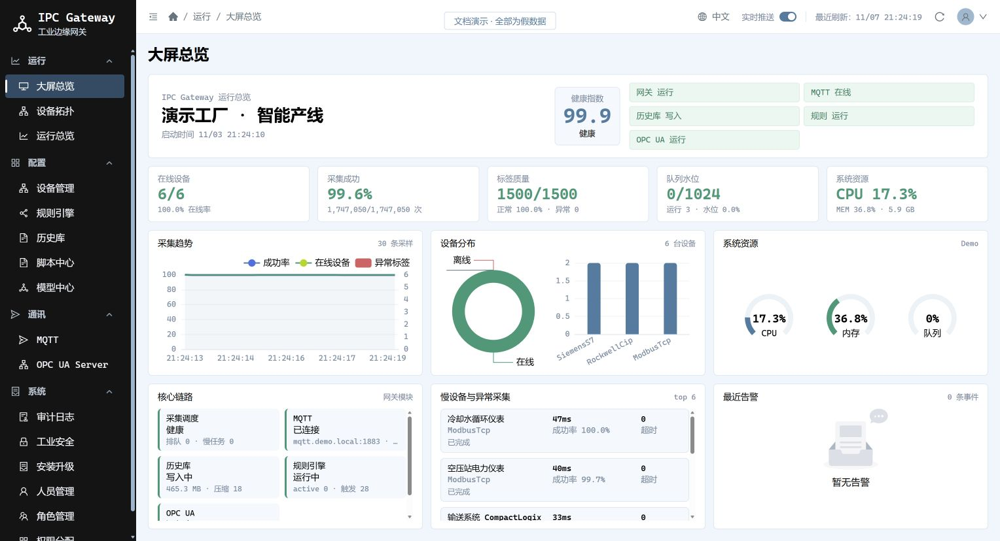
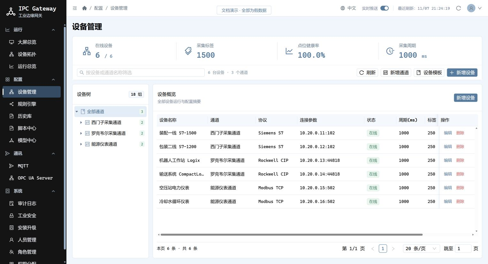
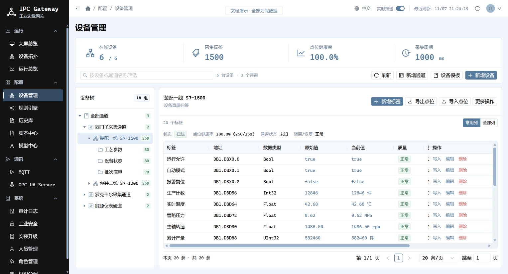
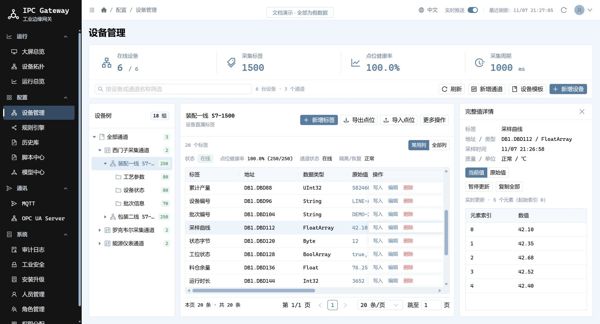
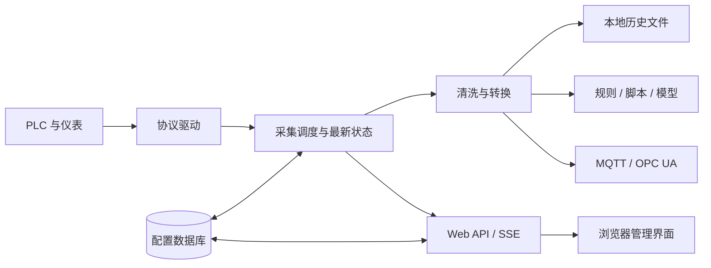

# IPC Gateway 工业边缘网关

IPC Gateway 面向制造业现场，连接 PLC、仪表和上位系统，将设备采集、数据处理、规则与脚本、MQTT/OPC UA 服务、历史记录及运维管理集中到一个 Web 系统中。

后端采用 **.NET 10 / ASP.NET Core**，前端采用 **Vue 3 / TypeScript / Ant Design Vue**。支持 Windows 服务、Linux systemd 和 Docker 部署。

[开发文档](docs/文档导航.md) · [架构与目录](docs/架构与目录说明.md) · [发布部署](docs/发布部署指南.md) · [ZIP 升级](docs/ZIP升级操作指南.md)

## 系统能力

| 模块 | 当前能力 |
| --- | --- |
| 设备与标签 | 通道、设备、分组、标签管理；按协议配置连接参数；批量导入导出；读写权限与采集周期 |
| 协议接入 | 西门子 S7、罗克韦尔 CIP/PCCC、Modbus、三菱、欧姆龙、ADS、OPC UA/DA、仪表及其他插件驱动 |
| 采集调度 | 设备隔离、批读、超时、失败恢复探测、背压与队列监控；异常点位和设备诊断 |
| 数据类型 | 标量、字符串、数组；按协议展示支持的类型；原始值与当前值查看、完整值抽屉 |
| 数据处理 | 缩放、单位转换、死区、重复值与毛刺过滤、枚举映射、压缩、采样、补点和聚合 |
| 规则引擎 | 阈值、组合条件、流程节点与动作，支持调试和状态查看 |
| 脚本与模型 | 脚本中心、数据库写入、本地 ONNX 推理及模型关联标签 |
| 北向服务 | MQTT、离线待发队列、Sparkplug B；OPC UA Server 支持安全模式与策略选择、标签浏览、订阅及按权限读写 |
| 运行监控 | 大屏、运行总览、设备拓扑、系统资源、模块状态、最近错误和健康检查 |
| 历史与审计 | 本地历史文件、冷热分层及保留策略，操作与配置变更审计 |
| 账号与权限 | 人员、角色、页面和操作权限，密码策略、登录锁定、API Token 与证书状态 |
| 运维升级 | 看门狗与单机自恢复、售后快照、安装包、ZIP 升级和程序回滚 |
| 界面体验 | 黑色菜单、浅蓝背景、白色卡片；中英文切换记忆；表格分页、列宽调整和固定操作列 |

系统已移除商业授权校验。驱动签名与升级包摘要/签名用于完整性及来源校验，不属于商业授权。
各协议的可用数据类型、批读方式和平台支持以驱动能力及目标环境为准。

## 系统界面

以下截图来自实际前端，使用独立的**演示假数据**：3 个通道、6 台设备、18 个分组、1500 个标签。
截图不连接现场数据库或 PLC，也不代表实时运行状态、性能结果或真实告警。详见 [截图说明](docs/截图与演示数据说明.md)。

### 大屏总览

设备在线、标签质量、采集趋势、资源使用和核心链路集中展示。



### 设备概览

按通道组织设备，查看协议、连接参数、采集周期和点位健康率。



### 标签与分组

展示多种数据类型、原始值、当前值及标签质量，设备树保留通道、设备和分组层级。



### 数组完整值

长字符串与数组可在详情抽屉查看，支持原始值/当前值切换、暂停更新和复制。



## 结构与数据流

```text
ipc.gateway/
├── src/                       产品源码与前端
│   ├── IPC.Gateway.Core/
│   ├── IPC.Gateway.DataProcessing/
│   ├── IPC.Gateway.FlowRules/
│   ├── IPC.Gateway.Inference/
│   ├── IPC.Gateway.LegacyProtocolPlugins/
│   ├── IPC.Gateway.Maintenance/
│   ├── IPC.Gateway.Mqtt/
│   ├── IPC.Gateway.Scripting/
│   ├── IPC.Gateway.Watchdog/
│   ├── IPC.Gateway.Web/
│   └── IPC.Gateway.WebHost/
├── script/
│   ├── windows/               安装、卸载、离线升级、生成安装升级包
│   ├── linux/                 systemd 发布与卸载
│   └── docker/                Dockerfile、Compose、发布与卸载
├── docs/                      中文开发文档、部署说明、参考配置与图片
├── IPC.Gateway.slnx            解决方案入口
├── Directory.Build.props      公共构建配置
└── README.md
```

测试项目、前端测试脚本、模拟器及英文兼容部署脚本已移除。生成的构建与发布产物放在 `artifacts`，不纳入产品源码。



配置数据库支持 SQL Server、PostgreSQL、MySQL 和 SQLite。项目配置、账号权限、审计与运行快照进入数据库；历史、待发消息、证书、脚本和模型文件需要单独持久化与备份。

## 本地开发

准备 .NET 10 SDK、Node.js/npm 和可用数据库。在仓库根目录打开解决方案；主配置位于 `src/IPC.Gateway.WebHost/appsettings.json`，生产配置参考同目录的示例文件。

```powershell
dotnet restore IPC.Gateway.slnx
Push-Location src/IPC.Gateway.Web
npm ci
npm run build
Pop-Location
dotnet build IPC.Gateway.slnx --no-restore
dotnet run --project src/IPC.Gateway.WebHost/IPC.Gateway.WebHost.csproj
```

访问地址以 WebHost 输出为准，常用地址为 `http://localhost:5184`。前端热更新开发在 `src/IPC.Gateway.Web` 执行 `npm run dev`，默认端口 5173。
首次管理员账号和生产密钥需要通过现场配置提供；仓库不提供可通用于生产部署的固定密码。

## 打包、部署和卸载

| 场景 | 中文入口 |
| --- | --- |
| 生成安装/升级 ZIP | [生成安装升级包](script/windows/生成安装升级包.ps1) |
| Windows 服务 | [安装](script/windows/安装Windows服务.ps1) / [卸载](script/windows/卸载Windows服务.ps1) |
| Windows 离线升级 | [执行离线升级](script/windows/执行离线升级.ps1) |
| Linux systemd | [发布](script/linux/发布Linux服务.sh) / [卸载](script/linux/卸载Linux服务.sh) |
| Docker，Windows 终端 | [发布](script/docker/发布Docker.ps1) / [卸载](script/docker/卸载Docker.ps1) |
| Docker，Linux 终端 | [发布](script/docker/发布Docker.sh) / [卸载](script/docker/卸载Docker.sh) |

Windows 上打包示例：

```powershell
& .\script\windows\生成安装升级包.ps1 -PackageType Install -RuntimeIdentifier win-x64
& .\script\windows\生成安装升级包.ps1 -PackageType Upgrade -RuntimeIdentifier linux-x64
```

默认产物在 `artifacts/packages`。整个仓库换盘或改名后可以继续打包；单独移动打包脚本时，传入 `RepositoryRoot` 指向包含 `src` 的源码根目录。
运行目标机需要 ASP.NET Core Runtime 10；Docker 镜像自行包含运行环境。详细操作见 [发布部署指南](docs/发布部署指南.md)。

| 环境 | 更新方式 |
| --- | --- |
| Windows 服务 | 网页上传 ZIP、校验、准备升级、执行并重启，支持程序回滚点 |
| Linux systemd | 目标平台 ZIP 解压后用发布脚本人工更新，当前没有网页一键执行器 |
| Docker | 发布新镜像并重建容器，保留配置与数据卷 |

卸载默认保留数据。Windows 升级包保留最新 1 个、程序回滚点只保留最新 1 个；程序回滚不回滚数据库。

### 首次部署与登录注意事项

1. **生产环境必须配置认证密钥。** Windows 服务使用 `Production` 环境，需要在正式程序目录的 `appsettings.Production.json` 中配置 `Gateway.Auth.Secret`，或通过 `Gateway__Auth__Secret` 环境变量提供。密钥应为至少 **32 个字符的随机值**，不能留空或使用默认占位值；否则认证接口会抛出异常并返回 HTTP 500。仅将 `appsettings.json` 复制为生产配置，不能保证这些必填项已配置；`appsettings.Production.example.json` 只是参考文件，不会自动加载。数据库中尚无管理员、需要首次创建账号时，还必须配置 `Gateway.Auth.BootstrapAdminPassword`。认证密钥不是登录密码，设置后应在后续更新中保留，不能将现场密钥写入仓库。修改配置后需重启服务。
2. **显示首页不一定表示登录验证成功。** 浏览器可能保存了以前的登录标记，当前前端会先显示首页，再向后台验证会话；如果认证接口返回 HTTP 500，页面可能停留在首页外壳并显示错误。应先修复后台配置、重启服务，再用无痕窗口访问，或清除该站点的缓存和登录状态后重新登录。清理浏览器缓存本身不能解决后台 HTTP 500。

## 运维入口与当前边界

- `/health/live`：进程存活；`/health/ready`：运行就绪；`/metrics`：按现场权限开放的运行指标。
- 采集、规则、历史、MQTT 等错误可从对应页面、审计日志和售后快照定位。
- SSE 向浏览器发送最新状态，避免后台标签页积压；中间值的长期保存由历史模块承担。
- 已有西门子仿真场景同时读取 1500 点位的验证记录；实际容量取决于协议、PLC、周期、点位类型和硬件，截图中的 1500 点为展示假数据。
- 当前具备单机恢复能力，尚未实现主备仲裁、防双主和双机热备。

## 开发文档

从 [文档导航](docs/文档导航.md) 查看全部中文资料。开发前阅读 [开发指南](docs/开发指南.md)，发布前阅读 [生产配置基线](docs/生产配置基线.md) 和 [发布验收清单](docs/发布验收清单.md)。

项目交流：Q 2673904969。
