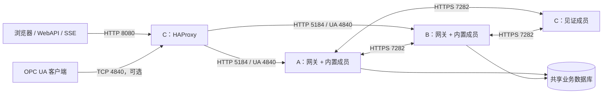
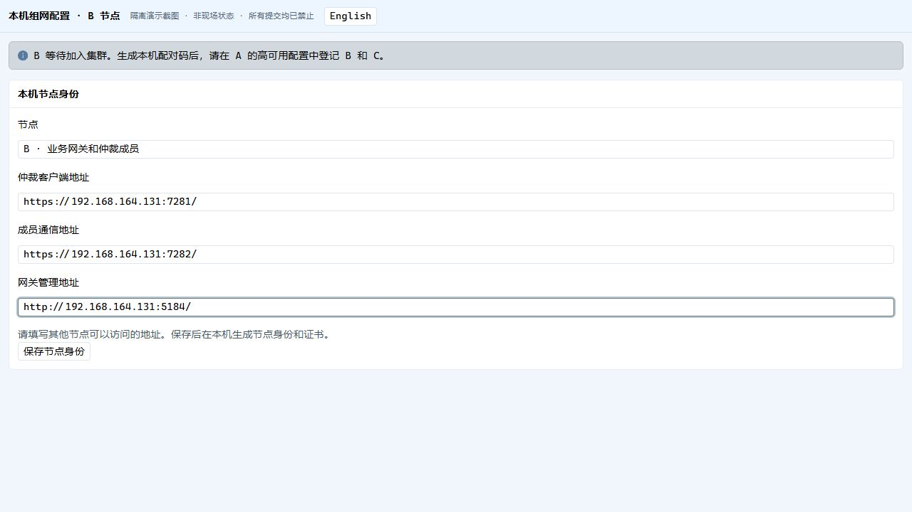
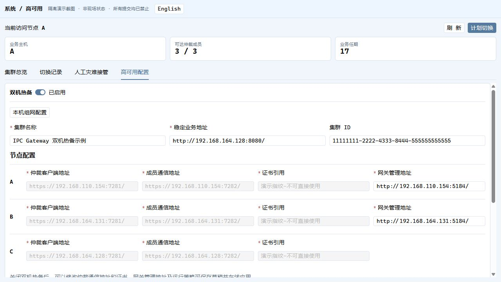
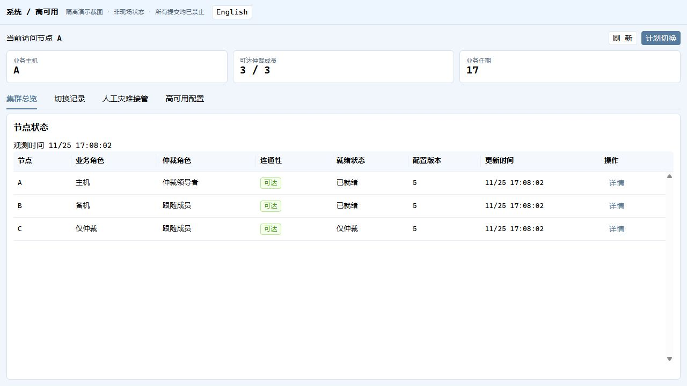

# 双机热备、防双主与反向代理部署指南

> 适用范围：当前源码中的 A/B 内置仲裁网关、C 独立见证，以及 HAProxy 统一入口。核对日期：2026-11-25。
>
> 截图使用真实前端组件和隔离演示数据，均标注“非现场状态”，不代表现场已经完成部署。IP、目录是本次环境示例；密码、密钥和配对码使用现场自己的值。

## 1. 最终部署结构

A、B 各安装 **一个网关服务**，内部包含各自的仲裁成员；C 安装一个独立见证服务。没有需要另外发布的“仲裁客户端服务”。HAProxy 可同时部署在 C，但它是另一个独立服务。

| 角色                    | 系统            | 服务名称                        | 目录示例                                                                                         |
| ----------------------- | --------------- | ------------------------------- | ------------------------------------------------------------------------------------------------ |
| A：业务网关、内置成员 A | Windows         | `IPCGateway`                    | 程序 `E:\IPCGateway\1731\app`；身份 `E:\IPCGateway\1731\ha-v2\A`；数据 `E:\IPCGateway\1731\data` |
| B：业务网关、内置成员 B | 统信 UOS x86_64 | `ipc-gateway.service`           | 程序 `/opt/ipc-gateway/app`；身份 `/etc/ipc-gateway/ha-v2/B`；数据 `/var/lib/ipc-gateway`        |
| C：独立见证成员         | 银河麒麟 x86_64 | `ipc-gateway-arbiter-c.service` | 程序 `/opt/ipc-gateway/arbiter-C`；身份 `/etc/ipc-gateway/ha-v2/C`                               |
| 统一访问代理            | 同一台 C        | `ipc-gateway-proxy.service`     | 程序 `/opt/ipc-haproxy/app`；配置 `/etc/haproxy/haproxy.cfg`                                     |

`1731` 是现有安装目录名称，不要求与升级版本号相同。升级继续使用原路径和原身份目录。B 如已使用其他数据目录，也应保留原值。



多数派和租约决定谁运行主业务；HAProxy 根据健康接口转发到当前业务主机。**代理不选主，也不能代替防双主机制。**

## 2. 端口总表：用途、位置与能否修改

**下表端口都可以修改。** 但“修改访问地址”“修改实际监听”“修改代理映射”是不同操作，需要同步。首次部署可先选定端口；已组网后修改 `7281/7282` 必须执行第 10 节三成员迁移。

| 默认端口 / 协议         | 部署位置、通信方向                    | 配置位置                                                             | 能否修改及需同步内容                                                 |
| ----------------------- | ------------------------------------- | -------------------------------------------------------------------- | -------------------------------------------------------------------- |
| `5184/TCP HTTP`         | A/B；浏览器、代理和管理通信访问网关   | Windows 安装入口 `-Url`；Linux `SERVICE_URL`；底层 `ASPNETCORE_URLS` | 可以。同步网页“网关管理地址”、HAProxy 后端及 UA 健康探针端口、防火墙 |
| `7281/TCP HTTPS`        | A/B/C；网关访问成员仲裁控制接口       | “本机组网配置 → 仲裁客户端地址”，生成文件的 `ClientUrl`              | 可以。首次直接填新端口；已组网按三成员迁移，同步成员登记和防火墙     |
| `7282/TCP HTTPS`        | A/B/C 两两互通；心跳、投票和共识      | “本机组网配置 → 成员通信地址”，生成文件的 `PeerUrl`                  | 可以。首次直接填新端口；已组网按三成员迁移，不能只改一台             |
| `7380/TCP HTTP`         | C 临时向导，只监听 `127.0.0.1`        | 直接启动 `IPC.Gateway.HaSetup.dll` 时的 `--localPort`                | 可以。使用输出的新本机链接；不对远程放行                             |
| `7381/TCP HTTPS`        | 首次组网，A 访问 B/C 的一次性配对入口 | A/B：`Gateway:EmbeddedArbiter:PairPort`；C：`--pairPort`             | 可以。同步 A 输入的配对地址与临时防火墙规则，不改变 `7281/7282`      |
| `8080/TCP HTTP`         | C；网站、WebAPI、SSE 统一入口         | `haproxy.cfg` 的 `frontend ipc_gateway_entry / bind`                 | 可以。同步“稳定业务地址”、探针 Host、访问链接与防火墙                |
| `8404/TCP HTTP`         | C 本机 HAProxy 统计页                 | `haproxy.cfg` 的 `listen ipc_gateway_stats / bind`                   | 可以。维持 `127.0.0.1` 监听                                          |
| `4840/TCP OPC UA`       | A/B 实际 UA 服务；C 可选 TCP 入口     | “通信 → OPC UA Server → 连接”；C 的 UA `bind` 与 `server`            | 可以。同步监听、对外公布端点、代理后端及防火墙；外部与后端可不同     |
| `1433/TCP SQL Server`   | 共享数据库；A/B 访问                  | SQL 实际监听；A/B `Gateway:Database`                                 | 可以。同步连接字符串 / 结构化端口、数据库防火墙；C 无需业务库        |
| `1883/8883/TCP MQTT`    | 外部 Broker；主网关向外连接           | “通信 → MQTT → 主机 / 端口 / TLS”及 Broker                           | 可以。与 HA 独立；HTTP 代理不会自动转发 MQTT                         |
| `443/TCP HTTPS`（可选） | HTTPS 网站或代理入口                  | HTTPS 监听、证书和代理 `bind`                                        | 可以。需要真实证书与对应 HTTPS 配置，不能只改 URL 文本               |

不同机器可以都使用 `7281/7282`；同一台机器的不同监听才需避免端口冲突。UA 客户端使用 `opc.tcp://`，不是 HTTP。

### 2.1 本环境应填写的完整地址

| 字段           | A                              | B                              | C                              |
| -------------- | ------------------------------ | ------------------------------ | ------------------------------ |
| 仲裁客户端地址 | `https://192.168.110.154:7281` | `https://192.168.164.131:7281` | `https://192.168.164.128:7281` |
| 成员通信地址   | `https://192.168.110.154:7282` | `https://192.168.164.131:7282` | `https://192.168.164.128:7282` |
| 网关管理地址   | `http://192.168.110.154:5184`  | `http://192.168.164.131:5184`  | 不填，C 没有业务网站           |
| 首次配对地址   | A 发起组网                     | `https://192.168.164.131:7381` | `https://192.168.164.128:7381` |

稳定业务地址：`http://192.168.164.128:8080`。

`7281/7282` 填 **HTTPS 根地址**，不要添加 `/cluster-consensus/raft`、`/v1` 或 `/IPC.Gateway`，请求路径由程序补齐。不能用其他机器无法访问的 `localhost`、`127.0.0.1` 或通配地址登记成员。

### 2.2 防火墙与网络放行

- A/B 的 `5184`：允许 C、指定运维客户端及 A/B 管理通信。
- A/B/C 的 `7281`：允许 A/B 网关访问；`7282`：三个成员双向互通。
- B/C 的 `7381`：仅配对期间允许 A 访问。生成配对码时临时监听，配对码 10 分钟到期后停止。
- C 的 `8080`：允许业务客户端访问。`8404/7380` 保持回环，不对外开放。
- UA 统一入口：客户端 → C 的 `4840`，C → A/B 的 `4840`。
- A/B 都必须能访问数据库、Broker 和 PLC；PLC 端口在各设备连接配置中设置，例如 S7 `102`、Modbus TCP `502`。

使用现场正在运行的 Windows 防火墙、firewalld 或 nftables 按来源放行，不需要关闭整机防火墙。

## 3. 部署前准备

### 3.1 运行环境与安装包

A/B/C 都需要匹配 x86_64 的 **ASP.NET Core Runtime 10**，只安装基础 .NET Runtime 不足。下载见 [Microsoft .NET 10 官方下载页](https://dotnet.microsoft.com/en-us/download/dotnet/10.0)。

目标机无需 Node.js。Linux 安装入口还需要 Bash、systemd、Python 3、rsync 和 ACL 工具。核对实际运行时：

```bash
/opt/dotnet10/dotnet --list-runtimes
```

应同时看到 `Microsoft.NETCore.App 10.x` 和 `Microsoft.AspNetCore.App 10.x`；Windows 使用 `dotnet --list-runtimes`。

干净的 Linux 首次安装时，从上述微软下载页选择 **ASP.NET Core Runtime → Linux x64 → Binaries**，下载 `aspnetcore-runtime-10.*-linux-x64.tar.gz` 并传入原生系统。不要选 SDK、Windows ZIP 或只有基础 .NET Runtime 的包。以专用目录 `/opt/dotnet10` 为例：

```bash
read -r -p '粘贴 ASP.NET Core Runtime tar.gz 完整路径：' runtime_archive
test -f "$runtime_archive"
sudo install -d -m 755 /opt/dotnet10
sudo tar --no-same-owner -xzf "$runtime_archive" -C /opt/dotnet10
sudo chown -R --no-dereference root:root /opt/dotnet10
sudo chmod -R u+rwX,go+rX,go-w /opt/dotnet10
sudo chown root:root /opt
sudo chmod go-w /opt
/opt/dotnet10/dotnet --list-runtimes
```

每条成功再继续。这里 `/opt/dotnet10` 必须是专门安装 .NET 的真实目录，不能指向个人可写目录；只调整 `/opt` 自身，不递归更改其余应用。已有运行时可先核对，无需重复覆盖。缺少系统动态库时按当前发行版官方依赖安装，不复制其他发行版的 libc。安装位置不同则同步后续所有 `DOTNET_PATH`。

从源码打包的开发机需要 .NET 10 SDK、Node.js/npm 及前端依赖；上面的 Runtime 要求针对部署目标机。开发机在 Windows 仓库根目录执行：

```powershell
Set-Location "E:\IPC\ipc.gateway"
$packageVersion = Get-Date -Format "yyyy.MM.dd.HHmm"

& ".\script\windows\生成安装升级包.ps1" `
  -Version $packageVersion -PackageType Install -RuntimeIdentifier win-x64

& ".\script\windows\生成安装升级包.ps1" `
  -Version $packageVersion -PackageType Install -RuntimeIdentifier linux-x64 `
  -UosSqlitePackage "E:\IPC\ipc.gateway\artifacts\packages\IPC.Gateway-2026.11.23.1307-linux-x64-sqlite-fix-uos-glibc2.28.zip"
```

`-UosSqlitePackage` 指向已验证的 glibc 2.28 兼容原生库包，文件迁移后替换实际路径。即使业务库选 SQL Server，内部报警等组件仍可能使用 SQLite，统信 glibc 2.28 不能忽略此依赖。

以脚本输出的 ZIP 路径为准。A 用 `win-x64`，B/C 用 `linux-x64`，不要互换。完整包解压后有 `payload`、`components`、`tools`。

### 3.2 共享数据库、加密密钥与身份

A/B 使用同一业务库，生产配置位置：

- A：`E:\IPCGateway\1731\app\appsettings.Production.json`。
- B：`/opt/ipc-gateway/app/appsettings.Production.json`。
- B 环境覆盖：通常 `/etc/ipc-gateway/ipc-gateway.env`，也可能来自 systemd Environment / EnvironmentFile。

| 配置                                       | 要求                                                |
| ------------------------------------------ | --------------------------------------------------- |
| `Gateway:Database`                         | 同一个共享业务库，地址从两台机器均可达              |
| `Gateway:Security:SecretStorage:Enabled`   | 两端一致；已有加密数据时保留启用                    |
| `Gateway:Security:SecretStorage:MasterKey` | 相同且能够解密已有数据，不随意重新生成              |
| `Gateway:Auth:Secret`                      | 相同的登录令牌签名密钥，与业务加密密钥不同          |
| HA 证书、私钥、Raft 日志                   | 每节点保留自己的身份与状态，不复制 A 整个目录给 B/C |

配置环境变量 `Gateway__Security__SecretStorage__MasterKey` 可覆盖 JSON 的 MasterKey；最终 MasterKey 为空时，程序才读取 `EnvironmentVariableName` 指定的变量，默认 `IPC_GATEWAY_SECRET_KEY`。两种来源也都没有显式密钥时会落到本机派生值，这不适合跨机器共享加密数据。**JSON 相同不代表进程有效密钥相同。** A/B 显式配置一致密钥，不把密码、密钥或完整生产配置提交 Git。

共享项目、规则、脚本及模型目录记录不等于共享所有本机文件。脚本绝对路径、外部模型资源需在 B 准备；历史文件与普通 MQTT 待发送队列也不因共用数据库保证无损接续。

### 3.3 独立故障域

SQL Server 若在 A 的物理电脑，A 整机断电后 B 可能因业务库不可用无法完整接管。B/C 虚拟机若也运行在 A 宿主机，A 断电会同时损失多个节点。这种部署适合功能验证，不能作为宿主级容灾结果。

正式部署应让 B、C 和数据库具备要求的独立供电、网络和故障域。

## 4. 安装 Windows A

以下是首次安装，已有集群更新见第 13 节。不能清空身份目录来解除旧集群状态。

1. Windows ZIP 解压到临时安装目录。
2. 管理员 PowerShell 进入解压根目录。
3. 注册服务，暂不加 `-Start`：

```powershell
.\tools\安装热备服务.ps1 `
  -Role A `
  -InstallRoot E:\IPCGateway\1731 `
  -ConfigRoot E:\IPCGateway\1731\ha-v2 `
  -DataDirectory E:\IPCGateway\1731\data `
  -Url 'http://0.0.0.0:5184'
```

4. 在程序目录准备 / 核对 `appsettings.Production.json`，使用共享业务库和生产认证配置。
5. 启动检查：

```powershell
Start-Service IPCGateway
Get-Service IPCGateway
Get-CimInstance Win32_Service -Filter "Name='IPCGateway'" |
  Select-Object Name, State, StartMode, PathName
```

6. 访问 `http://192.168.110.154:5184`。首次组网前提供管理网页，不表示已取得主业务身份。

要求全新 A 在组网前唯一运行单机采集时，可在首次安装加 `-StartAsStandalone`。它只适用未登记集群、身份目录为空且没有旧服务的新 A；不能用于已有集群绕过恢复。

`-Url` 是实际监听。若只填 `http://127.0.0.1:5184`，C 无法访问。

## 5. 安装统信 UOS B

### 5.1 ZIP 路径与中文解压

先定位真实文件名：

```bash
find /home/developer/Downloads -maxdepth 1 -type f -iname '*.zip' -print
read -r -p '粘贴 Linux 安装 ZIP 的完整路径（不加引号）：' gateway_zip
test -f "$gateway_zip"
```

上一条成功后继续。新打包脚本使用 UTF-8 文件名和正斜杠；兼容旧包反斜杠路径，可在同一 Bash 终端执行：

```bash
gateway_unpack_dir="$(mktemp -d /var/tmp/ipc-gateway-install.XXXXXX)"
python3 -X utf8 - "$gateway_zip" "$gateway_unpack_dir" <<'PY'
from pathlib import Path, PurePosixPath
import shutil, stat, sys, zipfile

root = Path(sys.argv[2])
with zipfile.ZipFile(sys.argv[1]) as archive:
    for entry in archive.infolist():
        name = entry.filename.replace("\\", "/")
        relative = PurePosixPath(name)
        if (relative.is_absolute() or ".." in relative.parts
                or not relative.parts or any(":" in part for part in relative.parts)
                or stat.S_ISLNK(entry.external_attr >> 16)):
            raise RuntimeError("不安全的 ZIP 路径：" + name)
        target = root.joinpath(*relative.parts)
        if name.endswith("/"):
            target.mkdir(parents=True, exist_ok=True)
        else:
            target.parent.mkdir(parents=True, exist_ok=True)
            with archive.open(entry) as source, target.open("xb") as destination:
                shutil.copyfileobj(source, destination)
if not (root / "tools" / "安装热备服务.sh").is_file():
    raise RuntimeError("缺少完整安装入口，请核对包类型和文件名编码")
print("解压成功：", root)
PY
```

看到“解压成功”再执行：

```bash
cd "$gateway_unpack_dir"
ls tools
```

不要重新压缩原 ZIP 修正路径，更新仍需原始 ZIP 的校验和与信任信息。旧包本身文件名编码损坏时，使用新打包脚本重新生成。

### 5.2 安装、配置与启动

先安装不启动：

```bash
sudo env \
  DOTNET_PATH=/opt/dotnet10/dotnet \
  INSTALL_DIR=/opt/ipc-gateway/app \
  DATA_DIR=/var/lib/ipc-gateway \
  SERVICE_URL=http://0.0.0.0:5184 \
  PACKAGE_ZIP="$gateway_zip" \
  START_SERVICE=0 \
  bash ./tools/安装热备服务.sh B /etc/ipc-gateway/ha-v2
```

准备 `/opt/ipc-gateway/app/appsettings.Production.json`，然后：

```bash
sudo systemctl start ipc-gateway.service
systemctl is-active ipc-gateway.service
systemctl is-active ipc-gateway-update.path
sudo systemctl status ipc-gateway.service --no-pager -l
```

访问 `http://192.168.164.131:5184`，核对网页就绪状态，进程 active 不等于业务已就绪。B 待命不表示启动失败。更新控制器 `.path` 应 active；按需运行的 `.service` 平时 inactive 可以正常。

遇到 `root-owned .NET installation`，核对专用 .NET 目录及父目录的 root 所有权、不可被组 / 其他用户修改的权限，修复后重新执行安装器。不要递归开放整个 `/opt`。

安装器为专属 HA 目录配置必要权限。错误时核对 ACL、服务用户、父目录遍历及 systemd `ReadWritePaths`，不要用 `chmod -R 777`。

## 6. 配置 C 见证，通过网页完成组网

### 6.1 麒麟使用原生文件视图

本次 C 存在 KARE 兼容环境，可能“安装成功但 systemd 找不到服务”，原因是终端和 PID 1 的根目录视图不同。在 C 进入原生环境：

```bash
sudo nsenter --target 1 --mount --root --wd -- /bin/bash --noprofile --norc
export PATH=/usr/sbin:/usr/bin:/sbin:/bin
unset LD_PRELOAD LD_LIBRARY_PATH BASH_ENV ENV
id -u
cat /etc/os-release
```

应显示 `0` 和原生银河麒麟信息。C 后续安装和服务操作在该窗口执行；[nsenter 说明](https://man7.org/linux/man-pages/man1/nsenter.1.html)。

安装 ASP.NET Core Runtime 10 到 `/opt/dotnet10`，重新定位 / 复制 Linux ZIP，按第 5.1 节解压。**进入原生终端后，原变量和兼容环境路径不一定可用，需要重新确认。**

### 6.2 C 本机向导

在 C 解压根目录执行：

```bash
env DOTNET_PATH=/opt/dotnet10/dotnet \
  bash ./tools/打开热备配置.sh /etc/ipc-gateway/ha-v2
```

在 **C 本机浏览器**使用终端输出的完整 `http://127.0.0.1:7380/#token=…` 链接。令牌不放入截图、文档或聊天。

1. 角色选择 `C`。
2. 仲裁客户端地址：`https://192.168.164.128:7281`。
3. 成员通信地址：`https://192.168.164.128:7282`。
4. 点击“保存节点身份”。C 无需网关管理地址或业务数据库。
5. 点击“生成配对码”，记录配对地址和短时配对码，保持向导运行。

向导在本机生成身份，通过配对登记信任，无需手工生成 PFX/CER 和复制指纹。

### 6.3 B 本机组网配置

直连 B 登录，进入“系统 → 高可用 → 本机组网配置”：

1. 节点应为 `B`，填第 2.1 节 B 的三个地址。
2. 点击“保存节点身份”。
3. 点击“生成配对码”，记录配对地址和当前配对码，保留页面。



### 6.4 A 创建集群

直连 A 登录，进入“系统 → 高可用 → 本机组网配置”：

1. 保存 A 本机身份，使用第 2.1 节 A 的地址。
2. “创建集群”填写下表。
3. 填写 B/C 的配对地址与各自有效的配对码。
4. 点击“生成组网配置”，核对后确认，三台写入各自文件。

| 字段         | 含义、示例                                                                                              |
| ------------ | ------------------------------------------------------------------------------------------------------- |
| 集群名称     | 显示名称，如“车间一 IPC Gateway 双机热备”                                                               |
| 集群 ID      | 首次手动填写固定唯一值，如 `ipc-gateway-ha-prod`；后续不变。复用共享库或旧身份时沿用原 ID，不能随意重建 |
| 稳定业务地址 | `http://192.168.164.128:8080`，长期入口；填它不会自动安装 HAProxy                                       |
| 首选业务节点 | 如 `A`；修改首选节点不等于立即计划切换                                                                  |
| B/C 配对地址 | `https://对应IP:7381`，不是 `7281`                                                                      |
| 配对码       | 对应节点刚生成的一次性码，过期重新生成                                                                  |

### 6.5 安装 C 服务，重启 A/B 并启用

配置成功后，在 C 向导终端 Ctrl+C 停止临时向导，从同一个解压根目录安装：

```bash
env DOTNET_PATH=/opt/dotnet10/dotnet START_SERVICE=1 \
  bash ./tools/安装热备服务.sh C /etc/ipc-gateway/ha-v2

systemctl is-active ipc-gateway-arbiter-c.service
systemctl is-enabled ipc-gateway-arbiter-c.service
systemctl status ipc-gateway-arbiter-c.service --no-pager -l
```

使用与向导相同配置根。C 程序默认在 `/opt/ipc-gateway/arbiter-C`。

A 管理员 PowerShell：

```powershell
Restart-Service IPCGateway
```

B：

```bash
sudo systemctl restart ipc-gateway.service
```

重新登录 A，进入“高可用配置”：

1. 核对集群名称、稳定业务地址、三个节点地址。
2. 续约和租约先用默认值；租约至少是续约间隔的三倍。
3. “保存草稿 → 连接预检”。
4. 预检通过后打开顶部“双机热备”开关，在“启用高可用”确认框点击“确认应用”；高危验证时输入当前账号密码并完成拼图。首次未启用时不需要寻找“完成组网”按钮，后续普通配置变更才使用“应用变更”。
5. 等待状态完成，不把“请求已提交”当成接管成功。



总览应有三成员可达、一个业务主机、另一网关待命就绪。`7281` 控制接口要求客户端证书，普通无证书 curl 返回 403 不等于成员故障；以网页预检为准。



## 7. C 部署 HAProxy：网站、WebAPI 与推送

本环境使用独立服务 `ipc-gateway-proxy.service`，不与 KARE 的 `haproxy.service` 混用。已安装成功时从配置核对开始，无需重复下载。

### 7.1 获取程序

[HAProxy 官网与下载入口](https://www.haproxy.org/#down)。示例使用发行版提供的 HAProxy 2.8 系列，参照 [2.8 配置手册](https://docs.haproxy.org/2.8/configuration.html)。

C **原生 root 窗口**先检查：

```bash
/opt/ipc-haproxy/app/usr/sbin/haproxy -v
```

若不存在，且 `apt-get` 是包装器、存在 `/usr/bin/apt-get.orig`，可从本机软件源下载到独立目录：

```bash
install -d -m 755 /opt/ipc-haproxy/packages
cd /opt/ipc-haproxy/packages
/usr/bin/apt-get.orig update
/usr/bin/apt-get.orig download haproxy
ls -l haproxy_*_amd64.deb
```

选实际文件路径：

```bash
read -r -p '粘贴 HAProxy deb 的完整路径（不加引号）：' proxy_deb
test -f "$proxy_deb"
install -d -m 755 /opt/ipc-haproxy/app
dpkg-deb -x "$proxy_deb" /opt/ipc-haproxy/app
ldd /opt/ipc-haproxy/app/usr/sbin/haproxy
/opt/ipc-haproxy/app/usr/sbin/haproxy -v
```

前条失败时停止。`ldd` 不应缺依赖。正常发行版可用原生包管理器，服务二进制路径按实际修改。不要添加其他发行版源或替换系统 libc 来凑兼容。

### 7.2 A/B 信任代理

在两边原生产配置的 **`Gateway` 对象内部**合并：

```json
"ForwardedHeaders": {
  "Enabled": true,
  "KnownProxies": ["192.168.164.128"],
  "KnownNetworks": []
}
```

这是局部配置，不替换整个文件，保留原有可信代理。根级 `AllowedHosts` 有限制时，加入实际主机名/IP，用分号分隔，不填协议或端口，例如：

```json
"AllowedHosts": "192.168.164.128;192.168.110.154;192.168.164.131;localhost"
```

保留现场其他合法主机名；这个配置位于 JSON 根级，与 `Gateway` 同级。

逐台重启生效，先备机，主机先交接业务。实际监听必须允许 C 访问。

### 7.3 写代理配置

创建账号与目录：

```bash
getent group haproxy >/dev/null || groupadd --system haproxy
id haproxy >/dev/null 2>&1 || useradd --system --gid haproxy \
  --home-dir /nonexistent --no-create-home --shell /usr/sbin/nologin haproxy
install -d -m 750 -o root -g haproxy /etc/haproxy
```

有旧配置先备份：

```bash
if [ -f /etc/haproxy/haproxy.cfg ]; then
  cp -a /etc/haproxy/haproxy.cfg \
    "/etc/haproxy/haproxy.cfg.before-ipc-$(date +%Y%m%d-%H%M%S)"
fi
```

以下保存到 `/etc/haproxy/haproxy.cfg`，可用 `sudo nano /etc/haproxy/haproxy.cfg` 编辑；已有其他代理业务时合并，不覆盖其他业务：

```haproxy
global
    log stdout format raw local0
    maxconn 2048
    user haproxy
    group haproxy

defaults
    log global
    mode http
    option httplog
    option dontlognull
    option http-server-close
    retries 0
    retry-on none
    timeout connect 2s
    timeout client 5m
    timeout server 5m
    timeout http-request 30s
    timeout http-keep-alive 10s
    timeout check 1s

frontend ipc_gateway_entry
    bind 0.0.0.0:8080
    acl exactly_one_active nbsrv(ipc_gateways) eq 1
    http-request deny deny_status 503 unless exactly_one_active
    http-request del-header Forwarded
    http-request set-header X-Forwarded-For %[src]
    http-request set-header X-Forwarded-Proto http
    default_backend ipc_gateways

backend ipc_gateways
    option httpchk
    http-check send meth GET uri /health/ha-active ver HTTP/1.1 hdr Host 192.168.164.128:8080
    http-check expect status 200
    default-server inter 1s fall 2 rise 2 on-marked-down shutdown-sessions
    server gateway_a 192.168.110.154:5184 check
    server gateway_b 192.168.164.131:5184 check

listen ipc_gateway_stats
    bind 127.0.0.1:8404
    mode http
    stats enable
    stats uri /
    stats refresh 2s
    stats show-legends
```

验证：

```bash
chown root:haproxy /etc/haproxy/haproxy.cfg
chmod 640 /etc/haproxy/haproxy.cfg
/opt/ipc-haproxy/app/usr/sbin/haproxy -c -f /etc/haproxy/haproxy.cfg
```

只放行“恰好一台”健康主机，零台或两台返回 503。`inter 1s` 是探测间隔，`fall 2/rise 2` 是连续失败/成功阈值。实际切换还需选主、旧租约结束、预热和客户端重连，不能承诺一秒完成。

### 7.4 健康接口认证与 HTTPS

C 检查 A/B：

```bash
curl -sS -i --connect-timeout 2 --max-time 3 \
  -H 'Host: 192.168.164.128:8080' \
  http://192.168.110.154:5184/health/ha-active

curl -sS -i --connect-timeout 2 --max-time 3 \
  -H 'Host: 192.168.164.128:8080' \
  http://192.168.164.131:5184/health/ha-active
```

正常一台 `200 {"active":true}`，另一台 `503 {"active":false}`。备机 503 正常。

`Gateway:Security:Api:RequireAuthenticationForHealth` 启用时保留认证，用 A/B 都接受的专用 Token。在 `http-check send` **同一行**末尾追加 `hdr X-API-Token YOUR_HEALTH_CHECK_TOKEN`，自定义 HeaderName 时用实际名称；真实 Token 不提交 Git。

若要求 HTTPS 或 `ApiTokens:RequireHttps=true`，探测必须走实际 HTTPS 后端、可信 CA 及主机名/SNI。本文 HTTP 配置不直接适用；不要关闭验证或伪造协议绕过要求。

### 7.5 注册服务并设开机启动

保存为 `/etc/systemd/system/ipc-gateway-proxy.service`，已有文件先备份：

```ini
[Unit]
Description=IPC Gateway HAProxy
After=network-online.target
Wants=network-online.target
StartLimitIntervalSec=60
StartLimitBurst=5

[Service]
Type=simple
WorkingDirectory=/etc/haproxy
ExecStartPre=/opt/ipc-haproxy/app/usr/sbin/haproxy -c -f /etc/haproxy/haproxy.cfg
ExecStart=/opt/ipc-haproxy/app/usr/sbin/haproxy -W -f /etc/haproxy/haproxy.cfg
Restart=on-failure
RestartSec=5
LimitNOFILE=8192
TimeoutStopSec=30
StandardOutput=journal
StandardError=journal

[Install]
WantedBy=multi-user.target
```

配置不加 `daemon`，由 systemd 管理前台 master-worker。若旧服务占端口，先用 `systemctl show haproxy.service -p FragmentPath -p ExecStart` 核对，确认是旧 KARE HAProxy 后才停用它，不动 C 见证。

```bash
chmod 644 /etc/systemd/system/ipc-gateway-proxy.service
systemctl daemon-reload
systemctl enable ipc-gateway-proxy.service
systemctl restart ipc-gateway-proxy.service
systemctl is-enabled ipc-gateway-proxy.service
systemctl status ipc-gateway-proxy.service --no-pager -l
ss -lntp
```

`active` 表示运行，`enabled` 才表示开机启动。当前服务无 `ExecReload`；改配置先 `haproxy -c`，通过后 `systemctl restart ipc-gateway-proxy.service`，会短暂断开既有连接。

### 7.6 验收网站 / WebAPI / SSE

- 网站：`http://192.168.164.128:8080`。
- WebAPI：原直连地址替换为 C 的 `8080`，API 路径、Token、请求内容不变。
- SSE：走同一入口，切换断开后前端重新建立连接。
- 统计：C 本机 `http://127.0.0.1:8404/`。

```bash
curl -sS -I --connect-timeout 2 --max-time 5 http://127.0.0.1:8080/
curl -sS --connect-timeout 2 --max-time 5 http://127.0.0.1:8404/
systemctl is-enabled ipc-gateway-proxy.service
```

计划切换成功会按程序设计退出当前会话，重新登录即可。HAProxy 不迁移登录会话；偶发切换能否保持登录还受共享会话、密钥及有效期影响。

## 8. OPC UA 统一入口：单独 TCP 转发

HTTP 代理 **不会自动代理 OPC UA**。

### 8.1 网页配置

“通信 → OPC UA Server → 连接”：

| 字段         | 推荐值                                       |
| ------------ | -------------------------------------------- |
| 监听主机     | `0.0.0.0`                                    |
| 监听端口     | `4840`                                       |
| 端点路径     | `IPC.Gateway`                                |
| 对外公布端点 | `opc.tcp://192.168.164.128:4840/IPC.Gateway` |

配置存入共享业务库。不能把 A/B 监听主机填成 C 的 IP。公布地址也不会自动创建 C 代理。

A/B 各用自己的服务端证书及私钥，保持逻辑 Application URI、命名空间、路径、安全策略一致。公布主机名/IP加入证书 SAN；重新生成证书后客户端需信任两份新证书。

### 8.2 C 增加 TCP 配置

追加到 `haproxy.cfg` 末尾，保留 HTTP 段：

```haproxy
defaults ipc_opcua_defaults
    log global
    mode tcp
    option tcplog
    option dontlognull
    retries 0
    timeout connect 2s
    timeout client 10m
    timeout server 10m
    timeout check 1s

frontend ipc_opcua_entry from ipc_opcua_defaults
    bind 0.0.0.0:4840
    acl exactly_one_opc_active nbsrv(ipc_opcua_gateways) eq 1
    tcp-request connection reject unless exactly_one_opc_active
    default_backend ipc_opcua_gateways

backend ipc_opcua_gateways from ipc_opcua_defaults
    option httpchk
    http-check connect port 5184
    http-check send meth GET uri /health/opcua-active ver HTTP/1.1 hdr Host 192.168.164.128:8080
    http-check expect status 200
    default-server inter 1s fall 2 rise 2 on-marked-down shutdown-sessions
    server opcua_a 192.168.110.154:4840 check
    server opcua_b 192.168.164.131:4840 check
```

`5184` 是 HTTP 探针，`4840` 是 UA 通信。`/health/opcua-active` 联合检查主身份、启动就绪、UA 启用与运行状态。有 Token/HTTPS 要求时同步第 7.4 节。

TCP 原样转发，不添加 `ssl` 或 `send-proxy`，UA 的 Sign / SignAndEncrypt 继续端到端工作。

```bash
/opt/ipc-haproxy/app/usr/sbin/haproxy -c -f /etc/haproxy/haproxy.cfg
systemctl restart ipc-gateway-proxy.service
```

客户端连接统一端点，测试浏览、读写、订阅和切换。SecureChannel、Session、订阅不迁移，客户端需重连并重建。写请求断线时结果可能未知，先核对设备状态，避免重复有副作用的写入。

## 9. 防双主、故障接管与人工干预

### 9.1 自动切换条件

| 场景             | 预期行为                                              |
| ---------------- | ----------------------------------------------------- |
| A/B/C 都在线     | 一个业务主节点，另一网关就绪待命                      |
| A 故障，B+C 正常 | B 就绪、业务依赖可用且旧租约安全结束后接管            |
| B 故障，A+C 正常 | 仍有两票，A 可继续 / 恢复业务，不应永久等 B           |
| C 故障，A+B 正常 | 仍有两票；本例 HAProxy 同在 C，统一入口失效，需要直连 |
| 仅剩 A 或 B      | 失去多数派，不自动继续正常集群主业务；走人工灾难接管  |
| 仅剩 C           | 无业务网关，不能采集发布                              |

停 A/B 网关服务也停止其内置成员。三个进程在线不等于数据库、驱动、脚本均就绪。

网关发布版本号和驱动列表可以不同，不因文本版本不一致直接拒绝授主；但控制协议、共享数据格式、平台及依赖仍须兼容。

### 9.2 写入保护范围

正常集群使用多数派、租约、任期、逐次写入许可。独立生效的写入分段重新授权，发送前再次检查身份；B 接管后 A 后续申请的新写入许可会被拒绝。

PLC 不识别任期，已获许可后进程恰好暂停、在途报文和写后响应丢失仍有边界，不能宣称 PLC 执行层绝对隔离。绕过公共受控传输的自定义驱动、外部 PLC 工具不在保护范围内；“已签名”不代表驱动实现所有高可用约束。

### 9.3 正常关闭热备

例如保留 A 单机业务：

1. 核对三节点与数据库，备份。
2. 停 B 网关服务，保留 A+C 在线。
3. **直连 A**，在“系统 → 高可用 → 高可用配置”关闭“双机热备”。
4. 完成确认、二次验证，等待关闭成功。
5. A 单机运行；恢复 B 时应保持业务暂停，不能启动另一份单机业务。

关闭模式需要多数派提交。不要先停 B+C 再尝试普通关闭开关。

### 9.4 仅剩一台：人工灾难接管

1. 现场确认另一业务网关已停机，或已与 PLC、业务网络隔离；超时本身不能证明隔离。
2. 直连存活网关，“系统 → 高可用 → 人工灾难接管”。
3. 查看“当前访问节点”，本机节点 ID 为大写 `A` 或 `B`，不是 IP、机器名或集群 ID。
4. 点击“人工灾难接管”，填原因、时长和节点 ID，勾选隔离确认并完成二次验证。
5. 等待业务真正就绪，数据库等依赖仍需可用。

默认 60 分钟，可选 15～1440 分钟；续期需验证。仅当前进程有效，重启不恢复。其他节点恢复可达、监测失败或期限结束会撤权。恢复现场前先退出人工接管，再恢复其他成员和正常授主。

不能在分区两边分别人工接管，否则人为制造双主。这是显式应急操作，不是一票自动选主。

## 10. 修改端口：首次部署与已组网分别处理

### 10.1 网站端口 5184 → 15184

首次安装用新监听。以下是放入完整安装命令的参数片段，不能单独运行：

```text
Windows：-Url 'http://0.0.0.0:15184'
Linux：SERVICE_URL=http://0.0.0.0:15184
```

已有服务维护时修改实际安装参数 / 服务定义，重启对应节点；Linux 核对 `ASPNETCORE_URLS` 的实际值。

还需同步：

1. A/B “网关管理地址”改为 `http://对应IP:15184`，保存草稿、预检、应用。
2. HAProxy `server gateway_a/gateway_b` 改后端端口。
3. UA 探针 `http-check connect port 5184` 改为 `15184`。两台管理端口不同时，应分别配置对应服务器的探针端口。
4. 防火墙、运维链接及其他探测同步修改。

逐台维护，保留其他两票；网页地址本身不会重新绑定监听。

### 10.2 首次改仲裁端口 7281/7282 → 17281/17282

在 A/B 本机组网界面和 C 向导填写：

| 字段       | A                               | B                               | C                               |
| ---------- | ------------------------------- | ------------------------------- | ------------------------------- |
| 仲裁客户端 | `https://192.168.110.154:17281` | `https://192.168.164.131:17281` | `https://192.168.164.128:17281` |
| 成员通信   | `https://192.168.110.154:17282` | `https://192.168.164.131:17282` | `https://192.168.164.128:17282` |

先选定再保存身份与配对。生成 `member.json` 后，成员按 `ClientUrl/PeerUrl` 端口实际监听，无需额外配置 IIS/Nginx。放行新端口。

### 10.3 已组网改仲裁端口、IP 或证书

**不能只编辑一台 member.json，也不能删 raft 重新注册。**

1. 备份业务库及三节点身份、证书、状态；Raft 使用节点停服后的完整一致副本，逐节点备份并恢复，不能把运行时随手复制多文件当作可靠备份。三成员均支持当前迁移功能。
2. 假设保留 A，先停 B，再由 A 按第 9.3 节关闭热备，保留 A+C 多数派。
3. 关闭后重启 B，以业务暂停状态参与准备，三成员管理通信需可用。
4. 直连 A，“高可用配置”修改受影响成员地址/端口，保存草稿。
5. 在“组网地址与证书变更”点击“准备组网变更”，按需要重新生成证书。
6. 核对三份计划与指纹，“确认组网变更”，等待登记完成。
7. “等待重启”表示文件已保存，旧监听还在运行。按计划 **依次重启 B、C、A**。
8. 同步网卡、DNS、Docker 映射、防火墙，预检后重新启用热备。

部分成员已写入时恢复通信、重试原计划，不另起计划、提前启用或清空状态。迁移保留集群 ID、节点与 Raft 历史；界面登记不会修改操作系统网络。

新控制日志格式不能仅换回旧 DLL；回退需恢复同一时点且互相匹配的程序、配置、证书、状态。

### 10.4 C 的 8080 / 8404

入口改为 `18080`：

1. HTTP `bind 0.0.0.0:8080` → `bind 0.0.0.0:18080`。
2. HTTP 和 UA 探针 Host → `192.168.164.128:18080`。
3. 网页稳定业务地址 → `http://192.168.164.128:18080`，保存草稿、预检、应用。
4. 防火墙、外部 API 地址和书签同步，校验配置后重启代理。

`8404` 改统计段 `bind 127.0.0.1:新端口`，维持回环监听。改入口不改变 A/B 的 `5184` 或 `7281/7282`。

### 10.5 OPC UA 端口

外部改 `14840`，后端保留 `4840`：

- C 的 UA frontend `bind` → `0.0.0.0:14840`。
- 网关公布端点 → `opc.tcp://192.168.164.128:14840/IPC.Gateway`。
- A/B 实际监听和 C 后端 `server ...:4840` 不变。
- 同步客户端与防火墙，校验、重启代理。

后端也改时，同步共享 UA 监听配置和 C 后端。HTTP 探针仍是管理端口。路径一致，主机名/IP变化时核对证书 SAN 与信任。

### 10.6 临时向导 / 配对端口

A/B 的 `7381` 在生产配置中合并以下内容，重启后生效：

```json
{
  "Gateway": {
    "EmbeddedArbiter": {
      "PairPort": 17381
    }
  }
}
```

这是片段，不覆盖原 `Gateway`。环境变量为 `Gateway__EmbeddedArbiter__PairPort`，不是 PairingPort。

C 直接在解压根目录运行：

```bash
/opt/dotnet10/dotnet \
  ./components/IPC.Gateway.HaSetup/IPC.Gateway.HaSetup.dll \
  --configRoot /etc/ipc-gateway/ha-v2 \
  --localPort 17380 \
  --pairPort 17381
```

用输出的 `127.0.0.1:17380` 完整令牌链接；A 输入 C 配对地址 `https://192.168.164.128:17381`。

现有“打开热备配置.ps1/.sh”不暴露这两个端口参数，自定义时用 DLL 入口。正式 C 服务使用已登记的仲裁端口，不依赖临时向导运行。

### 10.7 Docker 还需调整映射

| 环境变量                  | 当前 compose 语义                | 注意                                      |
| ------------------------- | -------------------------------- | ----------------------------------------- |
| `IPC_GATEWAY_HTTP_PORT`   | 宿主 → 容器固定 `5184`           | 不改变容器实际监听                        |
| `IPC_HA_PAIR_PORT`        | 宿主 → 容器固定 `7381`           | 不改变内置 PairPort，核对自动生成配对 URL |
| `IPC_ARBITER_CLIENT_PORT` | 宿主、容器客户端映射端口同时改变 | 不自动改 `member.json`，网页登记要同步    |
| `IPC_ARBITER_PEER_PORT`   | 宿主、容器成员映射端口同时改变   | 同上，已有集群需迁移                      |

建议首次宿主/容器同号。容器内配对端口也改时，需显式传 `Gateway__EmbeddedArbiter__PairPort` 并改 compose 右侧，不能只改宿主变量。持久卷各自独立，不能用空卷替换已运行成员。完整 Docker 安装见关联文档。

## 11. 文件、服务与源码速查

### 11.1 现场配置

| 内容               | 存放 / 生效位置                                                                          |
| ------------------ | ---------------------------------------------------------------------------------------- |
| A 生产配置         | `E:\IPCGateway\1731\app\appsettings.Production.json` 及服务环境                          |
| B 生产配置         | `/opt/ipc-gateway/app/appsettings.Production.json` 及 `/etc/ipc-gateway/ipc-gateway.env` |
| B 内置角色及身份根 | `/etc/systemd/system/ipc-gateway.service.d/90-ipc-ha.conf`                               |
| A/B 实际网站监听   | 安装器服务启动参数 / `ASPNETCORE_URLS`，不是 HA 地址字段                                 |
| A 仲裁身份         | `E:\IPCGateway\1731\ha-v2\A\member.json` 等                                              |
| B 仲裁身份         | `/etc/ipc-gateway/ha-v2/B/member.json` 等                                                |
| C 仲裁身份         | `/etc/ipc-gateway/ha-v2/C/member.json` 等                                                |
| C 见证服务         | `/etc/systemd/system/ipc-gateway-arbiter-c.service`                                      |
| C HTTP / UA 转发   | `/etc/haproxy/haproxy.cfg`                                                               |
| C 代理服务         | `/etc/systemd/system/ipc-gateway-proxy.service`                                          |

配置及运行期间，每节点保存 `identity.setup.json`、`topology.setup.json`、`member.json`、`member.pfx`、`member.password`、`raft/`；A/B 另有 `gateway-ha.json`、`gateway.pfx`、`gateway.password`、`gateway-state/`。状态目录由运行组件创建使用。升级保留，不发送私钥或密码文件来排障。

### 11.2 哪个类库是仲裁客户端

| 源码工程 / 文件                                                                                                                            | 职责                                                                                                     |
| ------------------------------------------------------------------------------------------------------------------------------------------ | -------------------------------------------------------------------------------------------------------- |
| [IPC.Gateway.HighAvailability](../src/IPC.Gateway.HighAvailability/IPC.Gateway.HighAvailability.csproj)                                    | **仲裁客户端类库**，由业务网关引用，发布后为 `IPC.Gateway.HighAvailability.dll`                          |
| [GatewayHaClient.cs](../src/IPC.Gateway.HighAvailability/GatewayHaClient.cs)                                                               | 客户端核心：成员通信、租约与主业务状态控制；同目录 `.Mode.cs`、`.Disaster.cs` 补充模式切换和人工灾难接管 |
| [IPC.Gateway.Arbiter](../src/IPC.Gateway.Arbiter/IPC.Gateway.Arbiter.csproj) / [ArbiterHost.cs](../src/IPC.Gateway.Arbiter/ArbiterHost.cs) | 仲裁成员程序与 HTTPS 主机；A/B 内置运行，C 独立运行                                                      |
| [EmbeddedGatewayMember.cs](../src/IPC.Gateway.WebHost/HighAvailability/EmbeddedGatewayMember.cs)                                           | 网关 WebHost 中内置仲裁的集成入口                                                                        |
| [IPC.Gateway.HaSetup](../src/IPC.Gateway.HaSetup/IPC.Gateway.HaSetup.csproj)                                                               | C 等节点本机配置向导，不是日常业务仲裁客户端服务                                                         |

发布脚本保留“发布仲裁客户端”等历史名称时，按其参数和发布的项目判断角色，不能把 `IPC.Gateway.Arbiter` 误认为上述客户端类库。

## 12. 常见问题

| 现象                                  | 优先核对                                                                   |
| ------------------------------------- | -------------------------------------------------------------------------- |
| 网站初始化中但进程 active             | 启动状态及原始日志：数据库、验签、脚本预热等；进程存活不等于就绪           |
| B 共享脚本连接解密失败                | A/B 有效 MasterKey，尤其环境覆盖；沿用能解密旧数据的值                     |
| SQL Server 已设置仍报 e_sqlite3/GLIBC | 内部组件仍用 SQLite，glibc 2.28 需兼容原生库                               |
| SQL“不支持的关键字”                   | 完整 `Server=IP,端口;Database=库名;...` 或正确结构化字段，不遗漏 `Server=` |
| 中文乱码、没有 tools                  | 新 UTF-8 正斜杠包 / 第 5.1 节解压，避免将反斜杠当文件名                    |
| 安装成功、unit not-found              | 终端与 PID 1 文件视图，进入原生系统                                        |
| Windows New-Service 拒绝访问          | 管理员 PowerShell                                                          |
| root-owned .NET 错误                  | 实际路径及父目录 owner/写权限，修复后重跑安装                              |
| start-limit-hit                       | 先修原始异常，再 reset-failed 和启动                                       |
| 7281 裸 curl 403                      | 需要证书，以网页预检确认                                                   |
| A→C / B→C 失败                        | IP、7282、路由、防火墙、证书，以及 C 原生服务                              |
| HAProxy 后端 503 DOWN                 | 备机正常；两台均 503 再查主权/就绪                                         |
| C 127.0.0.1:8080/8404 拒绝            | 在 C 检查专用服务、配置校验、监听                                          |
| C 重启后代理没启动                    | enable `ipc-gateway-proxy.service`，不是旧 KARE 服务                       |
| UA 地址公布 C 但连接失败              | C TCP 转发、4840、就绪探针、A/B 证书信任                                   |
| 只剩单机不能用                        | 已无多数派；符合隔离要求后人工接管，不清日志                               |
| 等待重启                              | 按已确认迁移计划 B→C→A 重启并预检                                          |
| 版本不同、操作等待                    | 检查实际详情与协议兼容，不因发布版本文字直接重建身份                       |

按节点选用只读检查：

```bash
# B：网站和业务启动
curl -sS --connect-timeout 2 --max-time 5 http://127.0.0.1:5184/api/startup/status
sudo journalctl -u ipc-gateway.service -b -n 120 --no-pager -a -o cat
sudo systemctl show ipc-gateway.service -p ExecStart -p FragmentPath

# C：见证与代理
sudo systemctl status ipc-gateway-arbiter-c.service --no-pager -l
sudo journalctl -u ipc-gateway-arbiter-c.service -n 80 --no-pager -a -o cat
sudo systemctl status ipc-gateway-proxy.service --no-pager -l
sudo journalctl -u ipc-gateway-proxy.service -n 80 --no-pager -a -o cat
sudo ss -lntp
```

日志发送前遮盖密码、Token、完整连接字符串。C 不运行 `5184` 网站。

麒麟文件视图检查：

```bash
sudo ls -l /etc/systemd/system/ipc-gateway-arbiter-c.service
sudo ls -l /proc/1/root/etc/systemd/system/ipc-gateway-arbiter-c.service
sudo systemctl show ipc-gateway-arbiter-c.service \
  -p LoadState -p FragmentPath -p ActiveState
```

第一处有、PID 1 根视图无文件时，回第 6.1 节，原生核对 .NET、程序、配置和服务，不是单纯切换 root 必然解决。

## 13. 后续更新

1. 备份共享库、生产配置、环境及三节点身份状态，保留原目录。
2. 按第 3.1 节打包命令，将 `-PackageType Install` 改成 `-PackageType Upgrade`，生成各平台 ZIP；统信继续含兼容 SQLite。完整的 Install ZIP 也包含对应组件，首次安装更新控制器时保留完整包。
3. 确认三成员全在线，无人工接管、无待完成迁移。
4. A 为主时，在“系统 → 高可用 → 集群总览”点击 B 行的“详情”，填写维护原因并点击“进入维护”。然后 **直连 B**，“系统 → 安装升级”，上传 Linux ZIP，核对兼容检查，“准备升级”，按页面“重启并执行升级”。
5. B 就绪后，在同一节点详情中填写原因并“退出维护”；计划切换到 B，完成后重新登录。
6. A 置维护，**直连 A** 上传 Windows ZIP 更新，恢复就绪后退出维护。
7. C 仲裁需要更新时按下方单独操作。A/B 网页升级不会顺带更新 C；仅前端变更不必重装 C。
8. 控制协议变更遵照版本兼容说明，保留原证书、WAL、状态。

“准备升级”需可核实多数派；集群“执行升级”还要求 **三成员可达、本机非主且已维护**。两票不代表可执行任意节点升级。

Linux 网页更新以前置安装更新控制器为条件，上传不能替代系统级安装。旧安装没有控制器时先用新完整包和原身份目录更新安装脚本。很旧的 Windows 版本若明确提示不支持新清单格式，按兼容文档评估首次过渡包的 `-LegacyUpgradeManifest`；不要对所有新包盲目加此参数。按钮已显示“已升级”时不重复执行。

### 13.1 C 的独立更新步骤

确认 A+B 均健康、可维持两票，当前不在迁移或灾难接管中；备份 C 原身份、配置和已停服状态。在 C 原生窗口解压新的 Linux 完整包，进入新解压根目录，然后执行：

```bash
systemctl stop ipc-gateway-arbiter-c.service
env DOTNET_PATH=/opt/dotnet10/dotnet START_SERVICE=1 \
  bash ./tools/安装热备服务.sh C /etc/ipc-gateway/ha-v2
systemctl status ipc-gateway-arbiter-c.service --no-pager -l
systemctl is-enabled ipc-gateway-arbiter-c.service
```

安装器不允许覆盖运行中的 C，所以先停见证。沿用原配置根与 Raft 目录，不重新配对、不新建空状态。这个过程不需要停止 `ipc-gateway-proxy.service`；C 恢复后从网关检查三成员重新可达，再继续其他维护。

详见 [ZIP 升级操作指南](ZIP升级操作指南.md)、[Linux 网页升级与平台兼容检查](Linux网页升级与平台兼容检查.md)。

## 14. 验收清单

- [ ] A/B 各一个集成网关，无重复旧仲裁。
- [ ] C 见证及代理分别 active、enabled，重启仍正常。
- [ ] 三成员预检通过，只有一个业务主机。
- [ ] 主机/备机探针分别 200/503，C 网站、API、推送正常。
- [ ] 计划切换完成后重新登录，切换记录有实际结果。
- [ ] 停主网关后，另一网关与 C 恢复业务。
- [ ] C 故障时 A+B 维持仲裁，运维知道代理入口也会失效。
- [ ] 单机不自动双主，人工接管及期限已验证。
- [ ] UA 切换后重连和重建订阅正常，两份证书均信任。
- [ ] A/B 均可访问 PLC、数据库、Broker。
- [ ] 测试不误写生产设备；端口、目录及密钥保管位置已记录。

## 15. 关联文档

- [双机热备安装、更新与卸载](双机热备卸载与重新发布.md)
- [高可用配置修改与灾难接管](高可用配置修改与灾难接管.md)
- [HAProxy 双机热备代理部署](HAProxy双机热备代理部署.md)
- [OPC UA 统一入口与主备切换](OPC%20UA统一入口与主备切换.md)
- [HTTP HAProxy 参考配置](参考配置/haproxy双机热备.cfg.example)
- [OPC UA TCP 参考配置](参考配置/haproxy-opcua.cfg.example)
- [三节点热备部署与验收](三节点热备部署与验收.md)

旧“三节点热备与防双主实施方案”是设计稿，部分 A/B 独立仲裁部署描述与当前不同；现场按本文的内置结构部署。
