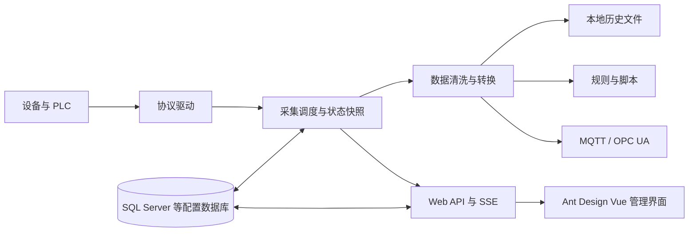

# 架构与目录说明

## 顶层结构

```text
ipc.gateway/
├── src/                        产品源码
│   ├── IPC.Gateway.Core/       领域模型、协议抽象、调度、采集、持久化
│   ├── IPC.Gateway.DataProcessing/ 数据清洗、压缩、采样和聚合
│   ├── IPC.Gateway.FlowRules/  流程规则引擎
│   ├── IPC.Gateway.Inference/  ONNX 模型推理
│   ├── IPC.Gateway.LegacyProtocolPlugins/ 协议驱动实现
│   ├── IPC.Gateway.Maintenance/ 离线账号维护工具
│   ├── IPC.Gateway.Mqtt/       MQTT 协议能力
│   ├── IPC.Gateway.Scripting/  脚本运行与数据库写入
│   ├── IPC.Gateway.Watchdog/   看门狗和自恢复
│   ├── IPC.Gateway.Web/        Vue 3 / Ant Design Vue 前端
│   └── IPC.Gateway.WebHost/    Web API、认证、静态站点与后台托管
├── script/
│   ├── windows/               Windows 服务、离线升级、生成安装升级包
│   ├── linux/                 systemd 发布与卸载
│   └── docker/                镜像构建、Compose、部署与卸载
├── docs/                      中文开发与运维文档、截图及参考配置
├── artifacts/                 本机生成的发布产物，不纳入版本控制
├── IPC.Gateway.slnx            产品解决方案入口
├── Directory.Build.props      公共 .NET 构建配置
└── README.md                   系统介绍和快速入口
```

仓库已移除测试项目、测试插件、压力测试项目、前端测试脚本和模拟器源码。`tmp`、`.vs` 和本地构建输出不是产品源码。

## 数据流



配置数据库保存项目、通道、设备、标签、账号、角色、审计及运行快照等信息。本地历史、MQTT 待发队列、证书、模型和脚本文件需要独立持久化，不能把数据库备份视为整套系统数据备份。

## 开发边界

- 新协议通过 `IProtocolDriver` / `IPlcClient` 接入，发布时带上 `Drivers` 目录及匹配的本机依赖。
- 数据处理放在 DataProcessing，规则放在 FlowRules，脚本放在 Scripting，模型放在 Inference，避免继续扩大单一核心类。
- WebHost 负责接口、认证和服务编排，不把界面布局放到后端。
- 前端只使用 Ant Design Vue 和 Ant Design SVG 图标；通用表格、分页、弹窗及多语言能力集中复用。
- 项目之间保留同级相对引用；从仓库根目录定位源码时，必须经过 `src`。
- Docker 的构建上下文仍是仓库根目录，Dockerfile 位于 `script/docker`。
- 对浏览器的 SSE 缓冲采用最新状态策略，不能用于替代历史记录或规则事件持久化。
